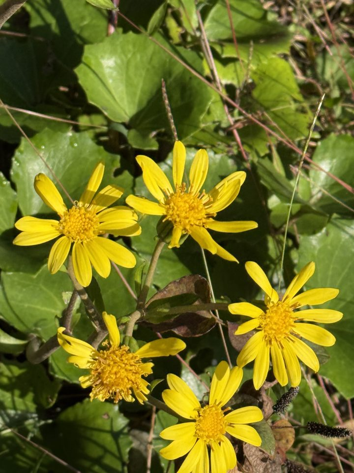

# seed — Claude と一緒に種を播く

**チャットしながらアプリを作っていくアプリ**です。畑で写真を撮り、Claude と話す。その記録を活用する。欄も設定の画面もなく、言葉で頼むと Claude が手引きを書き足し、画面を作り、記録を直します。

- **撮って、話す。** 写真を送ると、Claude が写っている物を読み、一つ問い返し、次に撮る物を言います。あなたは畑で見た事を返し、違えばそう言います。Claude は直して、また問います。その対話が記録になります。
- **記録は手元に。** 写真と座標の入った記録は、あなたの PC のプロジェクトフォルダー（`~/seed/`）に素の文字で残ります。人に見えるのは、あなたが「出す」と言った行と写真だけです。
- **機能は自分で足す。** 「これからは収穫の量も記録して」「収穫の表の画面を作って」と話すと、Claude が手引きと画面を足します。配布はこの GitHub だけで、使う人はフォークして自分の物にします。

<p align="center">


</p>
<p align="center"><sub>左: 「話す」の画面。Claude の読み、問い、次の一枚。右: 作者の畑で撮った一枚（位置の情報は外してあります）。</sub></p>


## 使ってみる

```bash
git clone https://github.com/aiseed-dev/seed.git
```

```bash
cd seed
```

```bash
python -m venv .venv && .venv/bin/pip install -e ".[app]"
```

Windows では `.venv\Scripts\pip install -e ".[app]"`。**配布はこの GitHub だけです。** PyPI にもアプリのストアにも出しません。使う人は、フォークして自分の物にします（下の「機能は自分で足す」）。

### 開く

```bash
.venv/bin/flet run
```

アプリの画面が開きます。写真を送ると Claude が読みます。記録は `~/seed/` に出来ます（下の「プロジェクトフォルダー」）。Claude Code と同じで、seed のフォルダーの中で開けばそのフォルダーが開き、上の端にその名が出ます。コードを直すと、開いたままの画面がその場で変わります。

### スマートフォンで試す

USB で繋いだ Android に、その場で入れて動かします（Flet 1.1 の開発の道）。

要る物: PC に Flutter と Android Studio（Android SDK）、スマートフォンの「開発者向けオプション」で USB デバッグを on。USB で繋ぐと、スマートフォンに「USB デバッグを許可しますか」と出るので許可します。

1. 繋がっているか見ます。表に ID（英数字）が出ます。

```bash
.venv/bin/flet devices
```

2. その ID で入れて動かします。初回は Flutter のビルドで数分、二回目からは一分ほどです。端末に「Flutter run key commands」と出たら、スマートフォンに seed の画面が出ています。

```bash
.venv/bin/flet debug android --device-id <ID> --arch arm64-v8a
```

3. 端末を開いたまま使います。Python を直したら端末で `R`（入れ直し）、終わるときは `q`（アプリも止まる）、端末だけ離れてアプリを残すなら `d`。アプリの Python のエラーは、この端末に出ます。

スマートフォンで撮った写真は、アプリの記録（アプリの入れ物の中）と、スマートフォンの `Pictures/seed/<日>/` の両方に残ります（Android。消すのは本人。iPhone の写真アプリは後で）。読みは、スマートフォンに Claude Code が無いので、自分の鍵か、招待コード（サーバーか、PC の `seed home`）で動きます。

iPhone は Mac で `flet debug ios`（[docs/iPhone 版.md](docs/iPhone%20版.md)）。

Play の「Flet」アプリで PC の seed を開く道（`flet run --android` と QR）もありますが、Play の Flet アプリは SDK 1.0.1 で、この seed の Flet 1.1.0 とは版が違い、作者の手元では繋がりませんでした。

### アプリにする

Flutter と Android Studio が要ります。

```bash
.venv/bin/flet build apk --arch arm64-v8a
```

出来た `build/apk/seed-farm.apk` をスマートフォンに入れます。iPhone は Mac で作ります（[docs/iPhone 版.md](docs/iPhone%20版.md)）。

作者が確かめたのは、Linux で開く所、`flet debug android` で実機に入れて動く所、Android の APK です。

## 画面

画面は二つと、足した分です。上の端の印で切り替えます。

- **話す**: Claude Code の画面のようなやり取りです。写真を送ると、Claude が今日の一枚を大きく出し、見つけた事を言い、一つ問い返し、次に撮るとよい物を言います。写真ごとに、写っている植物の名と状態のタグが付きます。違う所、計画、公開、「この土地の成り立ちを教えて」「オギの写真を見せて」「島根の写真はフォルダーを作って保管して」のような頼み事は、下の一行に言葉で書きます。PC では手元の Claude Code が受けます。Claude Code が無い PC とスマートフォンでも、自分の Claude の鍵（Anthropic の API の鍵。費用は自分）を入れるか、招待コードでサーバーを通すと、同じ事がアプリの中でできます（Claude にプロジェクトフォルダーの中だけに効く道具を渡し、アプリが端末の中で動かす。公開は全文を見て「出す」を押した時だけ送る）。
- **写真**: この畑の写真を日ごとに見渡し、タグ（植物の名、開花、刈った…）で絞り、大きく開いて「この草の名前は？」「今日の一枚にする」「この写真を外す」ができます。
- **この土地**: 座標から引いた、この土地の成り立ち（地形、土、水と災害の区域、歴史）と、昔の地図と空中写真。AI は使いません。これは最初のプラグインで、下の「機能は自分で足す」の見本です。

<p align="center">


</p>
<p align="center"><sub>話す（左）、写真を大きく開いた所（中。この草の名前は？、今日の一枚にする、この写真を外す）、この土地（右。出典付き）。</sub></p>

## プロジェクトフォルダー

```
~/seed/                  プロジェクトフォルダー（Claude Code の仕事場と同じ）
  CLAUDE.md              Claude Code を開いた時の決まり
  skill/                 手引き。言葉で足した事はここに入る
  plugins/               画面。一つの .py が一つの画面
  fields/北の畑/          畑ごとの記録
    observations/        観察（素の文字。読みの行、あなたの判定、あなたの言葉）
    photos/              写真（座標入り）
    place.md plan.md     土地の資料、栽培計画
    public/              公開した物の控え
```

`~/seed/` がプロジェクトフォルダーで、Claude Code の仕事場と同じ物です。記録（写真と座標を含む）、手引き（`skill/`）、画面（`plugins/`）、Claude Code を開いた時の決まり（`CLAUDE.md`）が、この中にあります。畑が二つ以上あるなら、中の `fields/<畑の名>/` に分け、上の端のフォルダーの印で畑か全体を選びます。座標はこの作業に必須で、記録から外しません。人に見える所に出るのは、あなたが了解した行と写真だけです（写真は位置の情報を外した物）。Claude Code がある PC なら API キー無しで動きます（Claude の契約は Pro 以上）。自分の鍵は端末の `~/.config/seed/credentials.toml`（600）にだけ置かれ、Anthropic の API にだけ送られます。

## 機能は自分で足す

畑は一枚ずつ違うので、機能は使う人が Claude と話して足します。三つの道があります。

- **言葉で足す。** 「これからは収穫の量も記録して」と話すと、Claude が `skill/` の手引きに書き足し、次からそうします。記録の種類、読む順、売り方、見せ方は、だいたいこれで足ります。
- **画面を足す。** 「収穫の表の画面を作って」と話すと、Claude が `plugins/収穫.py` を書き、上の端に印が増えます。ファイルは `TITLE`、`ICON`、`build(app)` の三つを持つだけです。見本は「この土地」（`src/seed/plugins/land.py`）。フォークは要りません。
- **芯を変える。** 撮る、位置、話すと写真の画面そのものを変えるなら、この seed をフォークして、自分の Claude Code に頼みます。フォークした seed はその人の物です。

あとは [docs/利用マニュアル.md](docs/利用マニュアル.md) のとおり。

## 作者の畑で（2026 年 11 月 2 日）

11 月 2 日の午後、徳島、藍のふるさとの元田んぼ。背丈を超えるセイタカアワダチソウと、オギかススキか分からない白い穂の草が一面を覆い、作物はカボチャが一株見えるだけでした。作者はそこで写真を撮り、そのあと草を刈り、記録に「はっきり言って土は固い」「地面に棒が入るのは、20cmぐらい」と書きました。

知りたかったのは、この土で何が育つか、棒が止まる固い層の下はどうなっているか、白い穂はオギなのかススキなのか、この土地はどうやってできたのか（地形、土、歴史）。

seed で 24 枚の写真を自分の Claude に渡すと（アプリは一度に 6 枚まで。CLI は枚数の上限無し）、写真に写っている物を書いた行が 17 行戻りました。草の名前は外れました。Claude は白い穂を「ススキらしい」と読み、作者が「違う（ススキではなくてオギ）」と付けました。土の固さは写真には写らない、と Claude 自身が書いています。地形（氾濫平野）と土壌図（水田化褐色低地土）の行は、Claude の読みではなく、座標から公開の地図を引いた物です。栽培計画（`plan.md`）の元になったのは、作者が記録に書いた言葉（元田んぼ、硬盤層、おそらくシルト質埴土、サブソイラにはトラクターが要る）で、Claude はそれを案に並べました。「あれだけオギが大きくなっているのを見れば土の状態はわかる」と読んだのも作者です。固い層の厚さはまだ分かりません。次に見ることとして計画に残っています。

畑を始めてみませんか。畑の写真と場所を自分の Claude に渡すと、写真に写る物を書き、座標から公開の地図（地形、土壌、史跡）を引きます。それを見て、あなたが畑で見た事を返す。違えばそう言い、Claude は直して、また問う。畑を観察し、Claude と話して記録にし、人と繋がる。自給農から、その次へ。seed はそのための手引きとアプリです。

## こんな人に

- 自給したいが、農業の経験が無い。
- 畑はまだ無い。気になる耕作放棄地が近所にある。
- 肥料も機械も種も、業者に預けてきた物を、自分で読める側に戻したい。
- AI を使ってみたいが、何に使えばいいか分からない。自分の畑なら答えが現実から返ってくる。

## 何が起きるか

1. 畑（か、道から見える耕作放棄地）を撮る。座標が入っていればそれでいい。
2. 写真を自分の Claude に渡す。手引き（[skill/](skill/)）を読んだ Claude が、その場所の公の資料（地質図、土壌図、地形、地名の由来、筆の形）を引き、草と地面を読んで、出典付きで返す。
3. あなたは観察した人として、読みに合う／違うを付ける。AI の行は仮説で、事実はあなたの言葉と出典付きの資料の行だけ。
4. 選んだ行と写真を公開する。公開は自分の Claude に頼む。Claude が下書きを作り（成長の記録。写真は、同じ場所を日を追って撮った物を日ごとに一枚）、写真と全文を見て「出す」と言う（アプリでは「出す」を押す）と送る。写真は縮めて、撮った場所などの情報（EXIF）を外して送る。公開された記録は seed.aiseed.dev（11-05 時点でまだ開いていません）で探せて、一言を添えて繋がれる。知識は、公の資料からではなく、一人ひとりの畑の記録と検証の積み重ねから作る。だから多くの人の協力と繋がりが要る。

こうしなさい、とは言いません。読み方であって、やり方ではありません。決めるのは畑です。

自給農から始めて、その次（売る、加工、宿や教室、手続き）を自分の AI と考える。seed の主題はそこにあります。

seed が持ち込むのは、作者の得意な生物学・気象・地質の読み（出典付き）で、農業のやり方ではありません。手引きもその順に並べ替えました。ただし気象の章はまだ骨組みだけで、記録に天気の行もありません。

## なぜ今か

- 田舎には荒廃農地が 25 万 7 千 ha あり、うち 9 万 8 千 ha は再生できる（農林水産省、2025 年 3 月末）。一反ずつなら 98 万区画。
- りん酸肥料の原料はほぼ全量が輸入で、りん安の輸入価格は 2020 年の 4 倍を超えた（財務省貿易統計、2026 年 7 月）。肥料を使わない作り方を出発点にする理由がある。
- 福岡正信は「一家族の糧は一反でよい」「農地が無いのではなく、自由に耕せる地目の土地が無いだけ」と書いた。その続きを、自分の Claude と一緒に、今の場所でやってみる。
- AI の時代に、ソフトウェア開発者は、自分の場所で使い、確かめ、直す人（ビルダー）になろう。自給農はその訓練の場になる。相手が畑なので、答えは現実から返る。

出典と確認日は [docs/基本計画.md](docs/基本計画.md) にあります。

## 自給農で学ぶこと

自然農法で作った作物には、慣行の作物には無い問題があります。これは「その次」に出てくる問題ではなく、自給農をしながら、自分の畑と台所で学ぶことです。seed は、それを自分の Claude と一緒に学ぶための物です。

- **揃わない。** 大きさも形も揃わない。市場の規格に合わせるのが難しいので、市場とは別の流通の道が要る。自分で食べながら、揃わない物をどう使い、どう分けるかを覚える。記録を見せて売る、はその一つ。
- **種が違う。** 慣行農業用の種は、肥料と農薬を前提に選ばれている。肥料を入れない畑の種は、菌根菌などの土の微生物と共存して育つ物でなければならず、自分で採って選んでいくことになる（手引き 10 章）。
- **料理が変わる。** 品種が変われば、料理の仕方も変えないといけない。まず自分の台所で覚え、それを買う人にどう伝えるかを考える。記録を一緒に渡す、はその答えの一つ（手引き 12 章）。


## ほかにできる事

座標から、公開の地図と空中写真を順に並べた一分ほどの動画を組むこともできます（`seed origin`）。
栽培計画の行から、季節ごとの図を線で描くこともできます（`seed grow`）。家の機械（GPU のある PC）で、その図を元に絵にもできます（`seed grow --draw`。写真は家から出ません。生成の絵は計画に無い物を描くことがあります）。どちらも仮説で、時期が来たら本人の写真と並べて合う／違うを付けるための物です。

**アプリは二つでひと組です。** 表は畑のアプリ `seed`、裏はそれを安全に動かすための守りの道具 `kagi`（同じ `pip install` で入ります）。seed を人に使ってもらう形で動かすと、入口のサーバー、家の機械、机の PC と、何台かの Linux の機械が要ります。`kagi app` は、その機械に誰が入れてどの鍵で入るかを表に書くと、今の形との差と直す手を見せる机の画面です。機械は変えず、鍵の値は読みません（[docs/kagi 手引き.md](docs/kagi%20手引き.md)）。

はじめて作物を作る人は、雑草か作物かが分かりません。seed は写真を [Pl@ntNet](https://plantnet.org/) に送って種の候補を取り、Claude の読みとは別の行として観察に足します（鍵があるとき。座標は送りません）。決めるのはあなたです。種の同定は Pl@ntNet の API によります（Pl@ntNet に感謝します）。コードは入っていますが、本物の鍵ではまだ通していません。使える形にするのは 11-08 の後の予定です。

## 作っている場所と期間

徳島の吉野川沿い、[藍のふるさと](https://japan-heritage.bunka.go.jp/ja/stories/story081/)から。吉野川の上流には、同じ三波川帯の結晶片岩の土の上で、斜面のままカヤをすき込んで耕してきた世界農業遺産[「にし阿波の傾斜地農耕システム」](https://giahs-tokushima.jp/steepslopeagriculture)があります。Built with Claude: Japan 2026（2026-11-02 12:00 JST の開始の後、12:30 から 11-08 20:00 まで）の間に、このリポジトリの全部を新しく書いています。同じ作者が別のハッカソン（Meta、2026-10-26〜11-04）向けに作ったパッケージ fieldnotes-farm を、座標からの照会にだけ、PyPI の 0.2.0 に固定して手を入れずに使います。記録の行の形は仕様（fieldnotes の docs/records.md）で共有し、コードは共有しません（境界は [docs/設計書.md](docs/設計書.md) §2）。

- [docs/基本計画.md](docs/基本計画.md) — 何を、なぜ
- [docs/設計書.md](docs/設計書.md) — どういう形で
- [docs/利用マニュアル.md](docs/利用マニュアル.md) — 使い方
- [docs/記録の形.md](docs/記録の形.md) — 記録のファイルの中身
- [docs/提出.md](docs/提出.md) — 提出の下書きと見直し

Built with Claude: Japan 2026 への提出です。テーマ 1「あなたにしかない深さを」。主題は **AI との付き合い方 — 業務システムと自然農法を比べてみた**（`docs/基本計画.md` §1、`docs/video/台本.md`）。seed は畑の側の道具、鍵の管理の仕組みと `kagi` は業務システムの側。アプリは Flet 1.1。動画は 11-07 に（リンクは提出の前に置く）。

使ってみた人、畑を見せてくれる人、違う所を言ってくれる人は、Discord「AI と一緒に自給農」へ: https://discord.gg/Q8pwMH2uTA

ライセンス: AGPL-3.0-or-later（[LICENSE](LICENSE)）。
