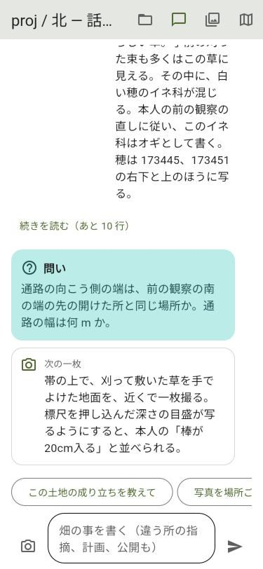
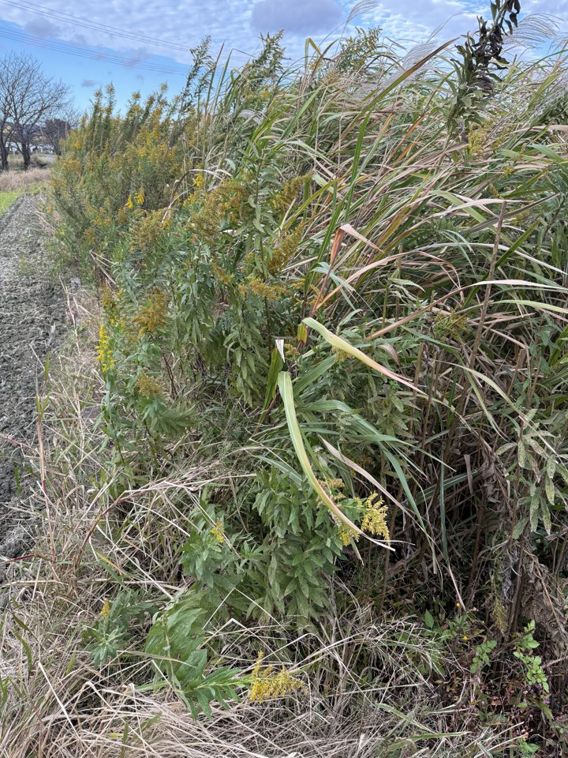
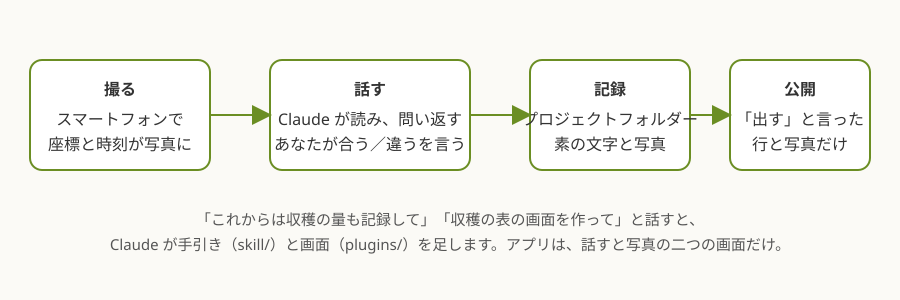
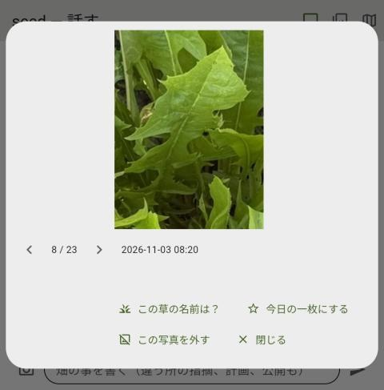
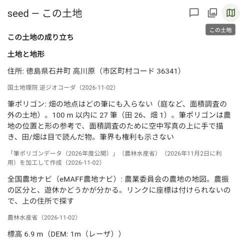

# seed — Claude と一緒に種を播く

**Claude と一緒に、耕作放棄地で自然農法をはじめる。** 畑で写真を撮り、Claude と話す。それが記録になる。記録をもとに、自分のアプリを作っていく。

- **記録を残す。** 撮った写真と話した事が、そのまま記録になります。記録は素の文字で、あなたの PC に残ります。畑は一回の確かめに一年かかります。季節が答えを返した時に見返せる物があるかどうかで、次の年が変わります。
- **アプリを作る。** 畑も人も一枚ずつ違うので、要るアプリは幾つもあります。天気予報、肥料の値段、草の名の同定、売るためのサイト。いいアプリがあれば使い、不便な所は直し、無ければ作る。「これからは収穫の量も記録して」「収穫の表の画面を作って」と話すと、Claude が手引きと画面を足します。

<p align="center">


</p>



## 使ってみる

```bash
git clone https://github.com/aiseed-dev/seed.git
```

```bash
cd seed
```

```bash
python -m venv .venv && .venv/bin/pip install -e ".[app]"
```

```bash
.venv/bin/flet run
```

アプリの画面が開きます。写真を送ると Claude が読みます。記録は `~/seed/` に出来ます。Windows では `.venv\Scripts\` の下の物を使います。

フォークして自分の物にしてください。直した物は戻せます。いいアプリが出来たら PyPI に上げます（例: 同じ作者の [fieldnotes-farm](https://pypi.org/project/fieldnotes-farm/)）。

### スマートフォンで試す

USB で繋いだ Android に入れて動かします。PC に Flutter と Android Studio、スマートフォンに USB デバッグの許可が要ります。

```bash
.venv/bin/flet devices
```

```bash
.venv/bin/flet debug android --device-id <ID> --arch arm64-v8a
```

端末に「Flutter run key commands」と出たら、スマートフォンに画面が出ています。Python を直したら `R`、終わるときは `q`。

アプリにするには `.venv/bin/flet build apk --arch arm64-v8a`。出来た `build/apk/seed-farm.apk` を入れます。iPhone は Mac で作ります（[docs/iPhone 版.md](docs/iPhone%20版.md)）。

## 画面

- **話す**: 写真を送ると、Claude が今日の一枚を大きく出し、見つけた事を言い、一つ問い返し、次に撮るとよい物を言います。写真ごとに、植物の名と状態のタグが付きます。頼み事は下の一行に言葉で書きます。PC では手元の Claude Code が受けます。スマートフォンでは、自分の Claude の鍵か、招待コードでサーバーを通します。
- **写真**: 月ごと、日ごとに見渡し、タグで絞り、大きく開いて「この草の名前は？」「今日の一枚にする」「この写真を外す」ができます。
- **この土地**: 座標から引いた、この土地の成り立ち（地形、土、水と災害の区域、歴史）と、昔の地図と空中写真。最初のプラグインです。

<p align="center">


</p>

## プロジェクトフォルダー

`~/seed/` がプロジェクトフォルダーです。Claude Code の仕事場と同じ物です。

```
~/seed/
  CLAUDE.md              Claude Code を開いた時の決まり
  skill/                 手引き。言葉で足した事はここに入る
  plugins/               画面。一つの .py が一つの画面
  fields/北の畑/          畑ごとの記録
    observations/        観察。読みの行と、あなたの言葉
    photos/              写真（座標入り）
    place.md plan.md     土地の資料、栽培計画
    public/              公開した物の控え
```

座標は記録から外しません。人に見える所に出るのは、あなたが「出す」と言った行と写真だけです（写真は位置の情報を外した物）。

スマートフォンの記録は PC に送れます。PC で `seed home` を打ち、出た URL と招待コードをスマートフォンの設定に入れると、撮った写真が PC に入り、PC の Claude Code が読みます。

## 機能は自分で足す

- **言葉で足す。** 「これからは収穫の量も記録して」と話すと、Claude が `skill/` の手引きに書き足します。
- **画面を足す。** 「収穫の表の画面を作って」「週の天気を出して」と話すと、Claude が `plugins/収穫.py` や `plugins/天気.py` を書きます。ファイルは `TITLE`、`ICON`、`build(app)` の三つを持つだけです。見本は `src/seed/plugins/land.py`。
- **芯を変える。** 撮る、位置、話すと写真の画面そのものを変えるなら、フォークして自分の Claude Code に頼みます。

詳しい使い方は [docs/利用マニュアル.md](docs/利用マニュアル.md) にあります。

## 作者の畑で

11 月 2 日、徳島の元田んぼ。背丈を超えるセイタカアワダチソウと、白い穂の草が一面を覆い、作物はカボチャが一株だけでした。写真を撮り、草を刈り、記録に「土は固い」「棒が入るのは 20cm ぐらい」と書きました。

24 枚の写真を Claude に渡すと、写っている物を書いた行が 17 行戻りました。Claude は白い穂を「ススキらしい」と読み、作者は「オギ」と言いました。土の固さは写真には写らない、と Claude 自身が書いています。地形（氾濫平野）と土壌図（水田化褐色低地土）は、座標から公開の地図を引いた物です。固い層の厚さはまだ分かりません。次に見る事として、計画に残っています。

## 作っている場所と期間

徳島の吉野川沿い、[藍のふるさと](https://japan-heritage.bunka.go.jp/ja/stories/story081/)から。Built with Claude: Japan 2026（2026-11-02 から 11-08）の間に書いています。

seed は、同じ作者の三つ目です。

- [aiai](https://github.com/aiseed-dev/aiai)（Zenn のハッカソン）: ふだん使っている AI に手引きを読ませ、AI とのチャットの履歴を使う。
- [fieldnotes](https://github.com/aiseed-dev/fieldnotes)（Meta のハッカソン）: 畑で写真を撮り、Meta の Muse で読む。
- seed: 写真を撮って Claude と話し、記録を残し、アプリを作っていく。

作る時は、作者が言葉で決め、Claude（Fable）が形と確かめをし、別の Claude（Opus、Sonnet）が書きました。

- [docs/基本計画.md](docs/基本計画.md) — 何を、なぜ
- [docs/設計書.md](docs/設計書.md) — どういう形で
- [docs/利用マニュアル.md](docs/利用マニュアル.md) — 使い方
- [docs/記録の形.md](docs/記録の形.md) — 記録のファイルの中身

Discord「AI と一緒に自給農」: https://discord.gg/Q8pwMH2uTA

ライセンス: AGPL-3.0-or-later（[LICENSE](LICENSE)）。
