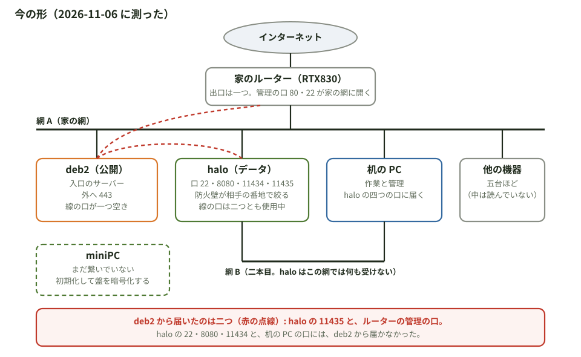

# 配線図と、ルーターの検討（2026-11-06 夜。作者「追加でルータも必要でしょう」「配線図も書け」「調べて、必要かどうか検討しろ」）

番地はここに書かない（対応は作業の場所の `配線.md`）。

## 1. 今の形（測った事）

| 測った事 | 結果 |
|---|---|
| 出口のルーター | ヤマハ RTX830（機種は作者から。番地の頭 AC:44:F2 の登録先もヤマハ）。次の中継は回線の会社で、間に別の箱は無い。動いているファームウェアの版は見ていない（入っていない） |
| ルーターの管理の口 | 80 と 22 が家の網に開いている。deb2 からも届く（RTX830 の初期値は、画面が家の網の全部から、ssh がどこからでも） |
| 外 → deb2 の 443 の道 | IPv4。deb2 の 443 に繋がっていた相手は 15 本とも Cloudflare の IPv4 の番地で、deb2 は家の網の番地で受けている。RTX830 が 443 を deb2 に転送している |
| deb2 → halo | 22・8080・11434 は届かない。**11435 は届く**（認証の無い口） |
| deb2 → 机の PC | 22・5432・631 とも届かない |
| 机の PC → halo | 22・8080・11434・11435 とも届く。二本目の網からは何も届かない |
| 防火壁（三台とも） | ufw が有効、入る向きの既定は拒否、IPv6 も有効。halo は相手の番地で絞っている |
| IPv6 で聞いている口 | halo は 22 だけ（8080・11434・11435 は IPv4 だけ）。deb2 は 22・443・2222 |
| 外から IPv6 で届くか | 測っていない（外の網の機械からしか測れない） |

## 2. ルーターに何をさせるか（調べた事）

| 出どころ | 書いてある事 |
|---|---|
| NIST SP 800-41 Rev.1 §2.2.1 | 機械ごとの防火壁は、要る通信だけを通す設定にすれば、同じ網の中の機械からも守る |
| 同 §2.2.2 | 機械ごとの防火壁があっても、網の入口の防火壁はもう一枚の守りになる。機械の側が壊れる、切られる、設定を誤る事があるから |
| 同 §3.1 | 外に見せるサーバーは別の口（DMZ）に置くのが普通。そうすると、そのサーバーと中の間の通信が防火壁を通る |
| 同 §3.4 | 防火壁の後ろに防火壁を置く形は、目的に合う事もあるが、一般には扱いにくい |
| NSA「家の網を守る最良の実践」（2023。本文は取れず、要約から） | 回線の会社の箱に分ける機能が無ければ自分のルーターを置く。守りの弱い機器を強い機器から分ける。IPv6 の防火壁。管理は中の網からだけ |
| 警察庁 令和 7 年上半期（都道府県警の転載から） | ランサムウェアの入口は VPN 機器 62%、リモートデスクトップ 22%。網の機器そのものが入口になっている |
| MITRE ATT&CK T1557.002 | ARP には相手を確かめる仕組みが無い。同じ網の機械は、他の機械の番地を名乗れる |
| ヤマハ コマンドリファレンス `lan type`（RTX830 に適用） | **LAN 分割**: スイッチの口ごとに別の IP の網にでき、網の間はルーターが中継する。**ポート分離**: 同じ IP の網のまま、口の組の間の通信を止める。LAN 分割とタグ VLAN は同じ口で併用できない。設定を入れると lan1 と lan2 が同時に一度切れる |
| 同 `httpd host`、`sshd host`（RTX830 に適用） | 管理の画面と ssh に入れる相手を、番地や口で絞れる。初期値は、画面が `lan`（家の網の全部）、ssh が `any`（どこからでも） |
| 同 `ip … secure filter`（RTX830 に適用） | 口ごとに、入る向きと出る向きの通す物を決められる。どの規則にも合わない物は捨てる。LAN 分割で作った口に掛けられるかは、この頁には書いていない |
| ヤマハ ファームウェアの一覧とリリースノート | RTX830 の最新は Rev.15.02.33（2025 年 7 月）。サポート終了の注記は無い。Web の画面の弱点（JVNVU#91161784）は Rev.15.02.20 で直っている |

## 3. 必要かどうか

**結論: 追加のルーターは要らない。今の RTX830 が、要る事を全部持っている。**

測った事と調べた事から、ルーターにさせる事は四つ。四つとも RTX830 の資料に載っている機能で、箱を足す理由が無い。

| させる事 | なぜ要るか（測った事） | RTX830 の機能 |
|---|---|---|
| 外の 443 を deb2 に渡す | 今もしている | 転送（今の設定） |
| 管理の口に入れる相手を絞る | deb2 から管理の画面と ssh に届く。公開のサーバーが破られると、次に出口のルーターを試せる | `httpd host`、`sshd host` |
| deb2 を別の網に分ける | 下の三つ | LAN 分割（口は四つ。deb2 を一つの口に直に繋ぐ） |
| 網の間で通す物を決める | 分けただけでは、網の間は中継される | `ip … secure filter` |

**網を分けると増える守りは三つ。**

- 機械の防火壁の設定を誤った時の、もう一枚（NIST §2.2.2）。halo の 11435 は、手で開けた規則が広すぎた例で、deb2 から届いていた。
- 同じ網の機械が番地を名乗る手（ARP）が効かなくなる。halo の防火壁は相手の番地で絞っているので、deb2 を root まで取られると、机の PC の番地を名乗って halo の四つの口に届く道が残る。
- 防火壁を持たない物が守られる。ルーターの管理の口と、他の機器五台。

**箱を足すと増える物。** 守る箱が一つ増える（警察庁の数字では、網の機器が一番の入口）。防火壁が二段になり、NIST も一般には扱いにくいと書いている。RTX830 でできる事のために、これを足す理由は見つからなかった。

**機械の側で塞げる穴。** halo の 11435 は、halo の防火壁でこの口の相手を絞れば閉じる。ルーターに触らない。

**確かめていない事。**

- この RTX830 で動いているファームウェアの版（最新は Rev.15.02.33）。
- LAN 分割で作った口に、フィルターを掛けられるか（資料の頁に書いていない）。
- 443 の転送が、相手を Cloudflare の番地に絞っているか。
- 外から IPv6 で届くか（外の網の機械からしか測れない）。
- 線がルーターのどの口に刺さっているか。機械は八台ほどで口は四つなので、間にスイッチがある。

## 4. 出どころ

- NIST SP 800-41 Rev.1 https://csrc.nist.gov/pubs/sp/800/41/r1/final
- NSA https://www.nsa.gov/Press-Room/Press-Releases-Statements/Press-Release-View/Article/3304674/nsa-releases-best-practices-for-securing-your-home-network/
- 警察庁の数字の転載（宮城県警） https://www.police.pref.miyagi.jp/cyber/pdf/r7-11-2.pdf
- MITRE ATT&CK T1557.002 https://attack.mitre.org/techniques/T1557/002
- ヤマハ `lan type` https://www.rtpro.yamaha.co.jp/RT/manual/rt-common/setup/lan_type.html
- ヤマハ LAN 分割機能 https://www.rtpro.yamaha.co.jp/RT/docs/lan-divide/index.html
- ヤマハ `httpd host` https://www.rtpro.yamaha.co.jp/RT/manual/rt-common/http_server/httpd_host.html
- ヤマハ `sshd host` https://www.rtpro.yamaha.co.jp/RT/manual/rt-common/setup/sshd_host.html
- ヤマハ `ip … secure filter` https://www.rtpro.yamaha.co.jp/RT/manual/rt-common/ip/ip_interface_secure_filter.html
- ヤマハ ファームウェアの一覧 https://www.rtpro.yamaha.co.jp/RT/firmware/index.php
- ヤマハ Rev.15.02.33 リリースノート https://www.rtpro.yamaha.co.jp/RT/docs/relnote/Rev.15.02/relnote_15_02_33.html
- ヤマハ JVNVU#91161784 https://www.rtpro.yamaha.co.jp/RT/FAQ/Security/JVNVU91161784.html
- 番地の頭の登録先 https://maclookup.app/macaddress/ac44f2
