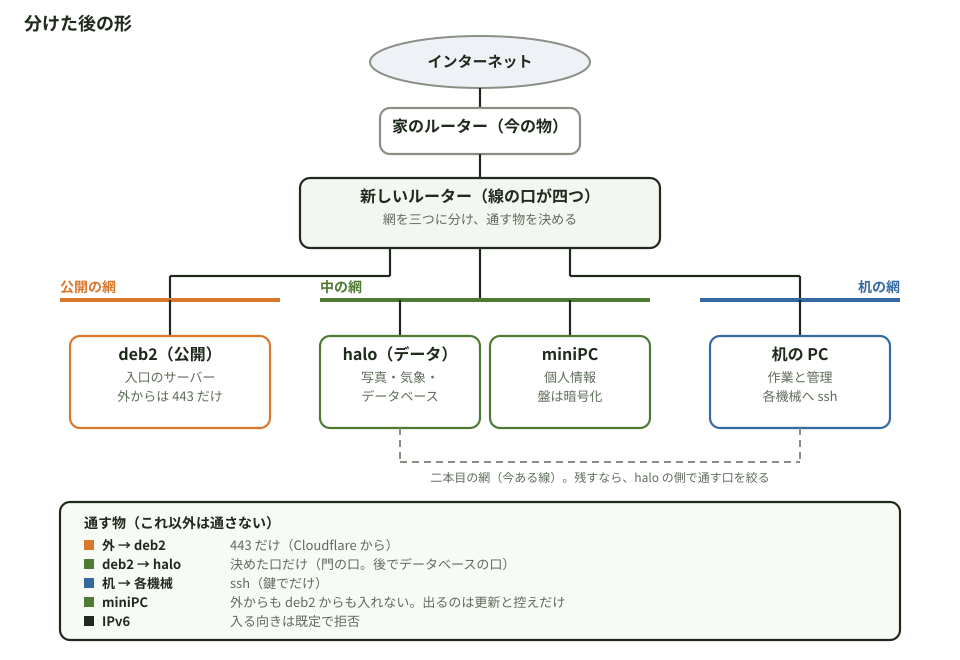

# 配線図（2026-11-06 夜。作者「追加でルータも必要でしょう」「配線図も書け」）

機械の役は `docs/kagi 計画書.md` §10。番地はこの文書に書かない（番地と線の口の名の対応は、作者の作業の場所 `~/farm/kagi/配線.md`。repo の外）。図は Fable が、三台（deb2、halo、机の PC）に dev の鍵で入って読んだ事実から描いた。ルーターの中と、線がどの口に刺さっているかは見ていない。

## 1. 今の形

読んだ事実:

| 機械 | 線の口 | 繋がっている網 | 見えた事 |
|---|---|---|---|
| deb2（公開） | 二つ（一つ使用、一つ空き）と無線 | 網 A | 外へ 443。Cloudflare の中継の常駐は動いていない（443 が届く道は、ルーターの転送か IPv6。未確認）。IPv6 の外向きの番地あり |
| halo（データ） | 二つ（両方使用）と無線（止まっている） | 網 A と網 B | 認証の無い口 8080・11434・11435 が外向き。IPv6 の外向きの番地あり |
| 机の PC | 二つ（両方使用） | 網 A と網 B | 各機械へ ssh |
| 他の機器 | — | 網 A | 番地が五つほど見えた。何かは読んでいない |
| miniPC | — | まだ繋いでいない | 初期化して盤を暗号化する（作者） |

出口のルーターは一つで、公開の deb2 も、halo も、机の PC も同じ網 A に居る。deb2 が破られると、halo と机の PC に直に届く。個人情報の miniPC を網 A に繋げば、そこにも届く。

## 2. 分けた後の形（案）

| 向き | 通す物 |
|---|---|
| 外 → deb2 | 443 だけ（Cloudflare から） |
| deb2 → halo | 決めた口だけ（門の口。後でデータベースの口） |
| 机 → 各機械 | ssh（鍵でだけ） |
| miniPC | 外からも deb2 からも入れない。出るのは更新と控えだけ |
| 中 → 外、公開 → 外 | 更新（80・443）、名前解決（53）、時計（123）。連載 第 5 章の出口と同じ |
| IPv6 | 入る向きは既定で拒否 |

要る物と、決める事:

- **新しいルーター。** 線の口が四つ（外、公開、中、机）。Debian の小さな機械で作れば、kagi の機械の表と写しでそのまま見られる。網を分けられる売り物のルーターでも足りる。
- **家の他の機器**（電話、家の物）をどの網に置くか。机の網か、今のルーターの下に残すか。
- **二本目の網**（halo と机の PC の間に今ある線）。残すと、机の PC から halo へルーターを通らない道になる。重いデータの受け渡しには便利。残すなら、halo の側の防火壁でその口を絞る。
- **deb2 への 443 の道。** 今がルーターの転送なら、新しいルーターに転送を移す。IPv6 で直に届いているなら、新しいルーターで入る向きを絞る。
- **順。** 止まる時間が出るので、(1) 新しいルーターを机の上で作って確かめる、(2) miniPC を中の網に最初から繋ぐ、(3) halo を移す、(4) deb2 を移す、の順が、公開の入口を止める時間が一番短い。

## 3. kagi が見ている物、見ていない物

見ている: 機械ごとの口（どの番地に向いて開いているか）、防火壁の既定（入る向き、出る向き）、入口（Caddy の設定の形）。
見ていない: 網をまたぐ通し方（ルーターの規則）、nftables の規則の中身、線の刺さり方、無線。ルーターを Debian で作った時に足す所。

## 4. 変更の記録

- 2026-11-06 夜: 初版（Fable）。
